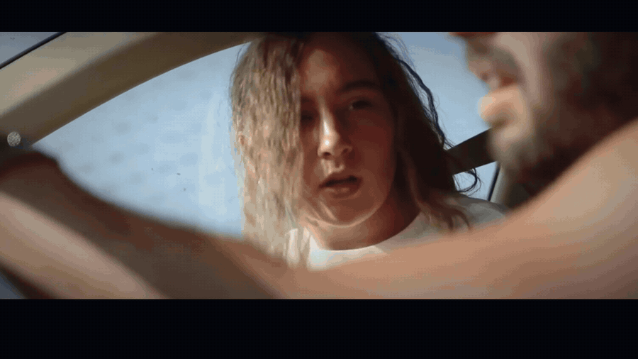
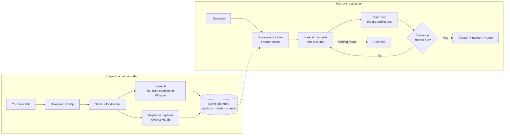

<div align="center">

# frameseek

**Ask anything about a YouTube video, whether it was *said* or only *shown*.**<br>
Get the answer with the moment it happens and the frame it was read from, or an honest "can't tell".
Runs on your own laptop with open-source models.

[](https://www.python.org/)
[](LICENSE)
[](#quickstart)
[](https://ollama.com/library/qwen3-vl)
[](https://pytorch.org/)
[](https://lancedb.com/)
[](https://www.gradio.app/)
[](https://docs.astral.sh/uv/)
[](#development)
[](https://github.com/imsoumya18/frameseek/commits)

[Quickstart](#quickstart) · [How it works](#how-it-works) · [Benchmark](#benchmark) · [Docs](docs/README.md) · [Roadmap](#roadmap)



</div>

---

## Why frameseek?

Most "chat with a video" tools search the **transcript**, so they only know what someone *said*.
Ask about what's *on screen* (a colour, a sign, an object, who's in the shot) and they guess.

frameseek looks at the frames too. It searches captions, frame pixels and speech together, then
**looks at the likely moments one at a time, zooms in, and checks its own evidence** before it answers.
When the evidence doesn't hold up, it says "can't tell" rather than make something up.

## Features

- 🎯 **Said *or* shown.** Answers from speech, on-screen text and the picture itself, fused into one ranked list of moments.
- 🔍 **Looks again, then zooms.** The vision model points to where the answer is (a grounding box), and frameseek crops the full-resolution frame and asks again to confirm.
- ✅ **Checks its evidence or abstains.** A quoted line must really be in the transcript or on screen and must answer the question; otherwise it keeps looking, then says "can't tell".
- ⏱️ **Answers with proof.** Every answer comes with its timestamp, the evidence crop, and a player that starts at that moment.
- 🔒 **Fully local.** Qwen3-VL through Ollama, Whisper, SigLIP2 and multilingual-e5 all run on your machine. No API keys, and nothing is uploaded.
- 🌏 **Built for Indian-language videos.** Tested on Bengali, Hindi and English. It catches YouTube captions tagged with the wrong language and falls back to Whisper.
- 🖥️ **One-screen web app.** Watch the preparation checklist and a live feed of every look, zoom and check. Click any candidate moment to jump there.
- ⚙️ **One config file.** Swap any model or setting in [`config.yaml`](config.yaml) without touching code.

## Quickstart

**Requirements:** Python 3.10+, [uv](https://docs.astral.sh/uv/), [ffmpeg](https://ffmpeg.org/) and
[Ollama](https://ollama.com). About 16 GB of RAM for the 8B answering model.

```bash
git clone https://github.com/imsoumya18/frameseek.git
cd frameseek
uv sync
ollama pull qwen3-vl:8b-instruct     # answers questions
ollama pull qwen3-vl:4b-instruct     # describes keyframes while preparing (faster)

uv run frameseek doctor              # checks ffmpeg, your device and the models
uv run frameseek ui                  # opens the web app
```

Paste a YouTube link and press **Prepare**. The first run downloads the video, finds the shots,
transcribes the speech, describes every keyframe and builds the index. All of it is cached, so
after that only the questions take time. Then ask away:

> *"What does she ask him for?"* · *"What is the man wearing around his neck?"* · *"গিটারিস্টের জামার রং কী?"*

Prefer the terminal?

```bash
uv run frameseek prepare "https://youtu.be/<video_id>"
uv run frameseek ask "https://youtu.be/<video_id>" "what colour is the car?"
```

## How it works



| Stage | What happens | Models and tools |
|---|---|---|
| **Download** | Fetches the video once, capped at 720p, into a per-video cache | yt-dlp, ffmpeg |
| **Shots and keyframes** | Cuts the video at scene changes and keeps one frame per shot, plus extra frames in long shots | PySceneDetect |
| **Speech** | Word-timestamped transcript from YouTube captions when their language checks out, otherwise local Whisper | faster-whisper `large-v3-turbo` |
| **Captions** | Describes each keyframe as structured JSON: people, objects, colours, on-screen text | Qwen3-VL 4B via Ollama |
| **Index** | Caption, frame-pixel and speech embeddings in a local vector database | multilingual-e5, SigLIP2, LanceDB |
| **Search** | Scores every frame against the question on all three sources, normalises each source (z-scores) and adds them up | |
| **Look, zoom, verify** | Checks moments one by one, crops the model's grounding box from the original frame, confirms, then checks quotes against the source | Qwen3-VL 8B via Ollama |

Each stage is explained from first principles in the [docs](docs/README.md), with diagrams and self-check questions.

## Benchmark

Hand-checked question sets for three videos in three languages, including questions about things that
**aren't** in the video, where the right answer is "not found" ([details](docs/10-benchmark.md)):

| Video | Language | Length | Questions | Right | Wrong | Can't tell | Absent things declined |
|---|---|---|---|---|---|---|---|
| Music video | Bengali | 4:46 | 21 | 18 | 1 | 2 | n/a |
| Speech with stock footage | English | 11:09 | 16 | 10 | **0** | 6 | 2 / 2 |
| Commentary with graphics | Hindi | 15:32 | 18 | 15 | **0** | 3 | 2 / 2 |
| **All** | | | **55** | **43** | **1** | **11** | **4 / 4** |

**98% right when it answers, and it answers 80% of the time.** It declined all four questions about
things that weren't in the videos. Retrieval puts a correct moment in the top 3 for 52 of 55 questions.

Measured on a 16 GB MacBook Air: preparing takes 15–20 s per keyframe, almost all of it describing frames
(10 minutes for the 2-minute short film in the demo), and a question takes 1.5–3 minutes. Speed is the main
open issue. See the [roadmap](#roadmap).

## Usage

<details>
<summary><b>All commands</b></summary>

```bash
# Prepare one or more videos: download, shots, speech, captions, index
uv run frameseek prepare "https://youtu.be/<id>" "https://youtu.be/<another_id>"

# Ask in the terminal (--mode look: one moment at a time with zoom, the default;
#                      --mode compare: the top 3 at once)
uv run frameseek ask "https://youtu.be/<id>" "what colour is the guitarist's shirt?"

# Web app (--port, --quiet to stop logging every step to the terminal)
uv run frameseek ui

# Score retrieval on a question set in evals/<id>.yaml; --answer runs the model too
uv run frameseek eval "https://youtu.be/<id>" --answer

# Run single steps
uv run frameseek ingest     "https://youtu.be/<id>"
uv run frameseek shots      "https://youtu.be/<id>"
uv run frameseek transcribe "https://youtu.be/<id>"
uv run frameseek caption    "https://youtu.be/<id>"
uv run frameseek index      "https://youtu.be/<id>"

# Debugging
uv run frameseek search "https://youtu.be/<id>" "woman in a red saree"   # raw scores per source
uv run frameseek describe path/to/image.jpg -p "What colour is the car?"  # ask about any image
uv run frameseek bench-vision data/<id>/keyframes/kf_0010_00.jpg          # image size vs speed
```

</details>

<details>
<summary><b>What's cached per video</b></summary>

```
data/<video_id>/
├── video.mp4            the downloaded video
├── meta.json            duration, fps, codecs, available captions
├── shots.json           shot boundaries and chosen keyframes (with the settings used)
├── keyframes/           one JPEG per keyframe
├── transcript.json      speech with word timestamps, its source and language
├── captions.jsonl       one structured caption per keyframe (resumable)
├── index.lance/         vector tables: frames (caption + pixel vectors) and speech chunks
└── crops/               zoomed-in evidence saved while answering
```

Each step skips itself when its output exists, and runs again when the settings that produced it change.

</details>

## Configuration

Everything lives in [`config.yaml`](config.yaml):

```yaml
vision:
  model: qwen3-vl:8b-instruct   # answers questions
  num_ctx: 8192
caption:
  model: qwen3-vl:4b-instruct   # describes keyframes while preparing
answer:
  mode: look                    # look (one moment at a time, zoom) or compare (top 3 at once)
  look_n: 6                     # moments to check before saying "can't tell"
  verify: true                  # check quotes against the transcript and the screen
```

Each engine picks its own device. PyTorch models use CUDA, Apple Silicon (MPS) or the CPU. Whisper uses CUDA
or the CPU. The vision model runs wherever Ollama puts it (Metal on a Mac). Developed and tested on macOS (Apple Silicon).

## Documentation

The [`docs/`](docs/README.md) folder teaches the concepts behind each part, in the order they were built:

| # | Chapter | Covers |
|---|---|---|
| 1 | [Setup and architecture](docs/01-setup-and-architecture.md) | Two-phase design, model servers vs in-process models, prefill vs decode |
| 2 | [Video fundamentals](docs/02-video-fundamentals.md) | Containers and codecs, I/P/B frames, seeking, atomic caching |
| 3 | [Shot detection](docs/03-shot-detection.md) | Change scores, adaptive thresholds, precision vs recall |
| 4 | [Speech to text](docs/04-speech-to-text.md) | Spectrograms, encoder-decoder, word timestamps, hallucinations |
| 5 | [Vision-language models](docs/05-vision-language-models.md) | Patches to tokens, structured captions, constrained decoding |
| 6 | [Embeddings and search](docs/06-embeddings-and-search.md) | Contrastive learning, cosine similarity, exact vs ANN search |
| 7 | [Retrieval and answering](docs/07-retrieval-and-answering.md) | z-score fusion (and why rank fusion failed), answering from evidence |
| 8 | [Looking again](docs/08-look-again.md) | Token budgets, grounding boxes, crop and zoom, early stop |
| 9 | [Verify or abstain](docs/09-verify-or-abstain.md) | Made-up evidence, fuzzy quote checks, risk vs coverage |
| 10 | [Benchmark](docs/10-benchmark.md) | Three videos, three languages, absent-thing questions |

## Roadmap

- [x] Download, shots and keyframes, speech, keyframe captions, vector index
- [x] Fused search, answering with evidence, web app
- [x] Look again with grounding boxes and zoom
- [x] Verify quotes or abstain
- [x] Benchmark on three videos in three languages
- [ ] Indian scripts and languages: reading Bengali and Devanagari on screen, code-mixed questions
- [ ] Faster preparation and answering
- [ ] Results write-up

Known issues and ideas are tracked in [issues](https://github.com/imsoumya18/frameseek/issues).

## Development

```bash
uv sync
uv run pytest          # no network or real model needed: fakes and a generated test video
```

<details>
<summary><b>Code layout</b></summary>

```
src/frameseek/
├── cli.py           commands
├── config.py        typed config loaded from config.yaml
├── devices.py       CUDA / MPS / CPU selection
├── ingest.py        download, probe, cache
├── shots.py         shot detection, keyframes, contact sheet
├── transcribe.py    YouTube captions or Whisper, word timestamps
├── caption.py       structured keyframe captions with a resumable cache
├── index.py         LanceDB index: build, and score every frame
├── answer.py        z-score fusion, moments, answering from evidence
├── look.py          look again: one moment at a time, zoom, confirm
├── zoom.py          model boxes (0-1000) to crops of the original keyframe
├── verify.py        evidence checks: is the quote in the source? does it answer the question?
├── evaluate.py      scoring against a question set
├── pipeline.py      prepare() and Asker: the flow shared by the CLI and the web app
├── progress.py      the five preparation steps and what's already done on disk
├── app.py           Gradio web app
├── models/vision.py vision model interface and Ollama backend
└── models/embed.py  multilingual-e5 text and SigLIP2 image embedders
```

</details>

Issues and pull requests are welcome.

## Acknowledgements

Built on [Qwen3-VL](https://github.com/QwenLM/Qwen3-VL), [Ollama](https://ollama.com),
[faster-whisper](https://github.com/SYSTRAN/faster-whisper), [SigLIP2](https://huggingface.co/google/siglip2-base-patch16-224),
[multilingual-e5](https://huggingface.co/intfloat/multilingual-e5-small), [PySceneDetect](https://www.scenedetect.com/),
[LanceDB](https://lancedb.com/), [Gradio](https://www.gradio.app/) and [yt-dlp](https://github.com/yt-dlp/yt-dlp).
The demo uses the short film [*"hitched"*](https://www.youtube.com/watch?v=r11Lr4FILX8) by Benjamin Quirk.

## License

[MIT](LICENSE) © Soumyadeep Biswas. Models are downloaded separately and keep their own licences
(Qwen3-VL is Apache-2.0).

<div align="center">

Developed by **[Soumya](https://github.com/imsoumya18)** · If frameseek is useful to you, a ⭐ helps others find it.

</div>
