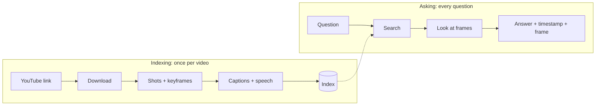

# frameseek

Ask questions about anything in a video, whether it was **said** or only **shown**,
and get the answer with the moment and the frame as evidence.

> "What colour was the car?" · "When does the idol first appear?" · "gaadi ka rang kya tha?"

frameseek runs entirely on your own machine with open-source models, and is being
built with Indian-language videos (Hindi, Bengali, Telugu and code-mixed speech) in mind.

**Status:** work in progress. The first end-to-end version works: prepare a video, then ask
questions in the terminal or a local web app. Next: looking closer at frames and verifying answers. See the [roadmap](#roadmap).

---

## Why

Most "chat with a video" tools search the **transcript**, so they can only find
what someone said. Questions about what is *on screen* (a colour, a sign, an
object, who is in the frame) need the frames themselves. Doing that well and
cheaply on a laptop, and for Indian-language content, is the goal of this project.

## How it works

frameseek splits the work into two phases:



Expensive work happens once at indexing time, so answering stays fast.

| Step | What it does | Status |
|---|---|---|
| Download | Fetches the video once (≤720p) into a per-video cache, keyed by video ID | Done |
| Shots + keyframes | Splits the video at cuts and keeps one frame per shot, plus extra frames in long shots | Done |
| Speech | Word-timestamped transcript: YouTube captions if their language checks out, else local Whisper | Done |
| Captions | A local vision-language model describes each keyframe as structured JSON (objects, colours, people, on-screen text) | Done |
| Index | Caption, frame-pixel and speech embeddings in a local vector database (LanceDB) | Done |
| Search + answer | Fuses the three rankings into moments; a vision model reads the top frames and answers with the moment and evidence | Done (v0) |

## Try it

```bash
uv run frameseek ui        # web app: paste a link, prepare, ask in English or Bengali
```

The answer comes with a YouTube player that starts at the moment it found, the
evidence frame, and the other candidate moments the model looked at.

## Quickstart

**Requirements:** Python 3.10+, [uv](https://docs.astral.sh/uv/), [ffmpeg](https://ffmpeg.org/),
and [Ollama](https://ollama.com) for the vision model.

```bash
git clone https://github.com/imsoumya18/frameseek.git
cd frameseek
uv sync
ollama pull qwen3-vl:8b-instruct

uv run frameseek doctor          # checks ffmpeg, device and the vision model
```

### Commands available today

```bash
# Download a video once (any YouTube URL form works; re-runs are instant)
uv run frameseek ingest "https://youtu.be/<video_id>"

# Split it into shots and extract keyframes (runs ingest first if needed)
uv run frameseek shots "https://youtu.be/<video_id>"

# Timestamped speech: YouTube captions if available, otherwise local Whisper
uv run frameseek transcribe "https://youtu.be/<video_id>"

# Describe every keyframe as JSON (runs ingest and shots first if needed)
uv run frameseek caption "https://youtu.be/<video_id>"

# Measure image size vs tokens, speed and caption quality on your machine
uv run frameseek bench-vision data/<video_id>/keyframes/kf_0010_00.jpg

# Embed captions, frame pixels and speech into a vector index
uv run frameseek index "https://youtu.be/<video_id>"

# Ask a question: answer, moment, evidence and a timestamped link
uv run frameseek ask "https://youtu.be/<video_id>" "what colour is the guitarist's shirt?"

# Score retrieval on a hand-checked question set (evals/<video_id>.yaml); --answer runs the model too
uv run frameseek eval "https://youtu.be/<video_id>"

# Raw retrieval from each source (before fusion and answering)
uv run frameseek search "https://youtu.be/<video_id>" "woman in a red saree"

# Ask the vision model about any single image
uv run frameseek describe path/to/image.jpg -p "What colour is the car?"
```

Everything for a video is cached in `data/<video_id>/`:

```
data/<video_id>/
├── video.mp4            downloaded video
├── meta.json            duration, fps, codecs, keyframe spacing, available captions
├── shots.json           shot boundaries and chosen keyframes (with the settings used)
├── keyframes/           one JPEG per keyframe
├── transcript.json      speech with word timestamps, its source and language
├── captions.jsonl       one structured caption per keyframe (resumable)
├── index.lance/         vector tables: frames (caption + pixel vectors), speech chunks
└── contact_sheet.jpg    every keyframe in a grid, for checking results by eye
```

Each step skips itself when its output already exists, and re-runs automatically
when the settings that produced it change.

## Measured so far

On a MacBook Air (16 GB), with a 4.8-minute music video:

| | Result |
|---|---|
| Shot detection | 84 shots found in 8.3 s (about 34x faster than real time) |
| Keyframes | 88, versus 143 if sampling a frame every 2 s |
| Vision model, one frame | ~20 s warm (14.5 s reading the image, 6.1 s writing the answer) |
| Vision model, image size | Ollama gives every frame ~1,200 tokens whatever size is sent (384 to 1024 px): image size is not a lever there |
| Captioning 88 keyframes | Qwen3-VL 4B: 18.2 s per frame, 27 min total (about 1.9x faster than the 8B; slower than benchmarked due to thermal throttling) |
| Search, 5 test questions | Every question answered by at least one of captions, frame pixels or speech; each source won at least one the others missed (~1 s per query including model warm-up) |
| Retrieval, 21 test questions | Right moment in the top 3 for 18/21 (z-score fusion), up from 15/21 with rank fusion; lyric questions 2/4 |
| Answering, 21 test questions | 8B picked a right moment for 16-17/21 across two prompt versions; ~15 answers fully right by eye; one prompt change turned a refusal into an invented quote (see Chapter 7) |
| Answering, 3 test questions (v0) | 1 right, 1 correct refusal, 1 wrong (small text unreadable); ~65 s per question with the 8B reading 3 frames |
| Speech, Bengali song | YouTube captions came out in Hindi (wrong uploader tag). Whisper `small` detects Bengali, `large-v3-turbo` transcribes it in Bengali script (~144 s) |

The last row is why the next steps index frames at low resolution with short
captions, and spend high-resolution compute only on the frames a question needs.
The reasoning is in [docs/01](docs/01-setup-and-architecture.md#where-the-time-goes-load-prefill-decode).

## Configuration

All models and settings live in [`config.yaml`](config.yaml). Swapping a model or
tuning shot detection is a one-line change, no code edits needed:

```yaml
vision:
  model: qwen3-vl:8b-instruct
shots:
  min_shot_s: 0.6     # ignore "cuts" closer together than this (camera flashes)
  every_s: 10.0       # extra keyframes inside long shots
```

Each engine picks its own device: PyTorch models use CUDA, Apple Silicon (MPS) or CPU;
Whisper uses CUDA or CPU; the vision model runs wherever Ollama puts it (Metal on a Mac).
`frameseek doctor` shows all three.

## Documentation

The [`docs/`](docs/README.md) folder explains the concepts behind each part, in
the order they were built, with diagrams and self-check questions:

- [Setup and architecture](docs/01-setup-and-architecture.md): two-phase design, model servers vs in-process models, prefill vs decode
- [Video fundamentals and ingestion](docs/02-video-fundamentals.md): containers and codecs, I/P/B frames, seeking, atomic caching
- [Shot detection](docs/03-shot-detection.md): change scores, adaptive thresholds, precision vs recall
- [Speech to text](docs/04-speech-to-text.md): spectrograms, encoder-decoder, word timestamps, hallucinations
- [Vision-language models](docs/05-vision-language-models.md): patches to tokens, structured captions, constrained decoding
- [Embeddings and search](docs/06-embeddings-and-search.md): contrastive learning, cosine similarity, exact vs ANN search
- [Retrieval and answering](docs/07-retrieval-and-answering.md): z-score fusion (and why rank fusion failed), retrieve-then-rerank, answering from evidence, measuring retrieval

See the [docs index](docs/README.md) for all chapters.

## Roadmap

- [x] 1. Setup and architecture
- [x] 2. Video download and caching
- [x] 3. Shot detection and keyframes
- [x] 4. Speech to text
- [x] 5. Frame captioning with a vision-language model
- [x] 6. Embeddings and vector search
- [x] 7. Search, answering and a web UI (first end-to-end demo)
- [ ] 8. Looking again: zooming into frames and locating objects
- [ ] 9. Verifying answers, or saying "can't tell"
- [ ] 10. Benchmark against transcript-only search and hosted models
- [ ] 11. Indian scripts and languages
- [ ] 12. Results write-up

## Development

```bash
uv run pytest        # runs without network or a real model; uses fakes and a generated test video
```

```
src/frameseek/
├── cli.py           commands
├── config.py        typed config loaded from config.yaml
├── devices.py       CUDA / MPS / CPU selection
├── ingest.py        download, probe, cache
├── shots.py         shot detection, keyframes, contact sheet
├── transcribe.py    YouTube captions or Whisper, word timestamps
├── caption.py       structured keyframe captions with a resumable cache
├── index.py         LanceDB index: build and per-source search
├── answer.py        z-score fusion, moments, answering from evidence
├── evaluate.py      scoring retrieval against a question set
├── pipeline.py      prepare() and Asker: the flow shared by CLI and UI
├── app.py           Gradio web app
├── models/vision.py vision model interface + Ollama backend
└── models/embed.py  multilingual-e5 text and SigLIP2 image embedders
```

## License

[MIT](LICENSE). Models are downloaded separately and keep their own licences
(Qwen3-VL is Apache-2.0).
