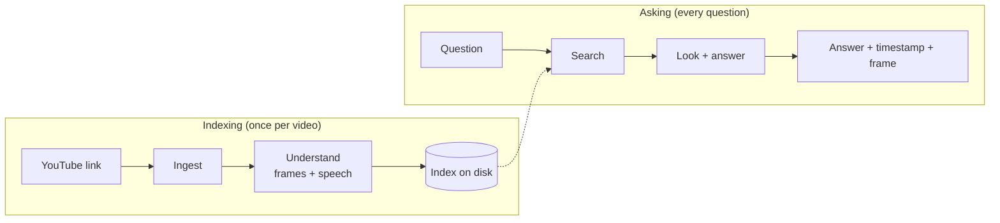

# 1. Setup and architecture

## Two phases: indexing and asking

Frameseek splits its work into two phases with very different requirements.

| | Indexing | Asking |
|---|---|---|
| When | Once per video | On every question |
| Speed needed | Can take minutes | Should feel instant |
| What runs | Download, shot detection, captioning, embedding | Search, then a vision model on a few frames |

A useful analogy is a library. Indexing is the librarian cataloguing a new book.
Asking is the librarian answering "where is the part about X?" from the catalogue,
without re-reading the book.



Almost every design decision follows from this split: push expensive work into
indexing so that answering stays fast.

## Where models run: a server or inside our process

Frameseek uses two styles of running models.

| | Separate server (Ollama for the vision model) | Inside our process (faster-whisper, SigLIP2) |
|---|---|---|
| Main advantage | Stays loaded across runs. Restart the Python script many times while developing and the 6 GB model loads once. | No overhead. Results come back as arrays directly, with no HTTP or JSON conversion. |
| Also | Any language can call it; a crash in it does not take our app down; it manages quantization and the GPU | Simple setup (`pip install`); we decide exactly when to load and free it |
| Downside | One more thing that must be running | Reloaded on every run; can crash our app |

The rule of thumb: large, slow-to-load models get a server. Small, fast-loading
models live in-process.

Note that a separate process does **not** stop models competing for memory. On
Apple Silicon the CPU and GPU share one pool of RAM (unified memory), so every
model's weights come out of the same budget whichever process holds them.

## Device abstraction: CUDA, MPS or CPU

| Device | What it is | Who has it |
|---|---|---|
| CUDA | NVIDIA's GPU platform | Linux / Windows with an NVIDIA card |
| MPS | Apple's GPU backend for PyTorch | Apple Silicon Macs |
| CPU | Works everywhere, slowest | Everyone |

The code never hard-codes a device. `pick_device()` in `devices.py` returns the
best one available, which is what lets the same code run on any machine. Ollama
picks its own device, so this only matters for in-process models.

## Interfaces and config: swapping models without touching code

Each kind of model sits behind a small interface:

```python
class VisionModel(Protocol):
    def stream(self, image: Path, prompt: str) -> Iterator[Event]: ...
    def describe(self, image: Path, prompt: str) -> str: ...
```

The rest of the code depends only on this interface, and `config.yaml` chooses the
implementation. Comparing two models becomes a one-line config change, which is
what makes benchmarking cheap later.

The config loader rejects unknown keys, so a typo like `modle:` fails loudly
instead of being silently ignored.

## Where the time goes: load, prefill, decode

A single call to a vision-language model has three phases. These numbers are from
a MacBook Air (16 GB) running Qwen3-VL-8B through Ollama:

| Phase | What happens | Limited by | Example |
|---|---|---|---|
| Load | Copy ~6 GB of weights from disk into memory | Disk speed; paid once while the model stays loaded | ~20 s on first call, 0 s after |
| Prefill | Read all input tokens (image patches + prompt) in parallel | **Compute** | 1,092 tokens in 14.5 s |
| Decode | Generate the answer one token at a time | **Memory bandwidth**: every token re-reads all weights | 96 tokens in 6.1 s (15.7 tok/s) |

Two practical consequences:

1. **Image size drives prefill.** The model cuts an image into patches, and each
   patch is a token. Halving each side of the image gives roughly a quarter of
   the tokens, so prefill becomes about four times faster.
2. **Answer length drives decode.** Short, structured captions are much cheaper
   than long descriptions.

This is why Frameseek indexes frames at low resolution with short captions, and
only spends high-resolution compute on the few frames a question actually needs.

`keep_alive` in `config.yaml` controls how long Ollama keeps the model loaded
after a call. Measure speed on warm runs and report the cold start separately.

## Check your understanding

1. A user asks 10 questions about one video. Which components run 10 times, and
   which run once?
2. Why does a separate server process not save memory on Apple Silicon?
3. You double the longest side of the input image. Roughly what happens to the
   prefill time, and why?
