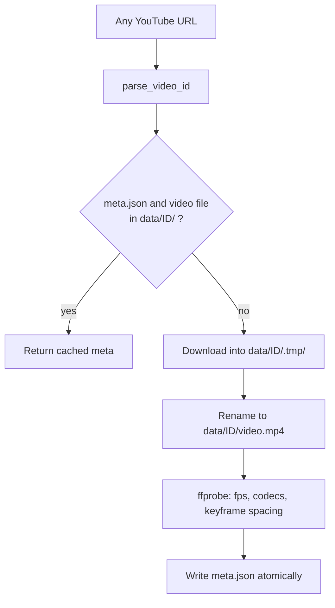

# 2. Video fundamentals and ingestion

Code: [`src/frameseek/ingest.py`](../src/frameseek/ingest.py)

## Container vs codec

A video file is a box (the **container**) holding separate tracks, each
compressed with a **codec**.

| | What it is | Examples | Analogy |
|---|---|---|---|
| Container | File format that holds the tracks and their timing | `.mp4`, `.mkv`, `.webm` | A zip file |
| Video codec | How the pictures are compressed | H.264, VP9, AV1 | How each photo inside is compressed |
| Audio codec | How the sound is compressed | AAC, Opus | Same, for sound |

"It's an MP4" describes the box, not the compression. The same `.mp4` can hold
H.264 or AV1 video.

## Why most frames are not complete pictures

Ten minutes at 30 fps is 18,000 frames. Storing each as a full image would be
huge, so codecs store a few complete pictures and describe the rest as changes.

| Frame type | Contains | Can be decoded alone? |
|---|---|---|
| **I-frame** (keyframe) | A complete picture | Yes |
| **P-frame** | Changes from the previous anchor frame | No, needs earlier frames |
| **B-frame** | Built from anchor frames before **and after** it | No, needs frames on both sides |

The run from one I-frame to the next is a **GOP** (group of pictures):

```
 I  B  B  P  B  B  P  B  |  I  B  B  P  B  B  P  B
 └──────── GOP 1 ───────┘   └──────── GOP 2 ───────┘
```

Real videos usually have an I-frame every 1 to 10 seconds. `ingest.py` measures
this for each video and stores it as `keyframe_interval_s` in `meta.json`.

## Seeking: what it costs to get one frame

To show the frame at 7.9 s, the decoder must start from the I-frame **before**
7.9 s and decode every frame up to it.

Worked example: keyframes every 4 s at 30 fps. The last keyframe before 7.9 s is
at 4.0 s, so ffmpeg decodes (7.9 − 4.0) × 30 ≈ **117 frames** to return one.

That is why frameseek extracts one keyframe per shot (Chapter 3) rather than
sampling arbitrary timestamps, and why the ffmpeg flag order matters:

| | Command | Speed |
|---|---|---|
| Fast seek | `ffmpeg -ss 12.3 -i video.mp4 -frames:v 1 out.jpg` (`-ss` before `-i`) | Jumps to the nearest keyframe, then decodes a short stretch |
| Slow seek | `ffmpeg -i video.mp4 -ss 12.3 -frames:v 1 out.jpg` (`-ss` after `-i`) | Decodes from the start of the file |

Measuring the keyframe interval uses the same idea: `ffprobe -skip_frame nokey`
tells the decoder to touch only I-frames, so it is fast even on long videos.

## What YouTube actually serves

YouTube stores separate **video-only** and **audio-only** streams at many
resolutions and codecs, and the player switches between them as your network
changes. This is adaptive streaming (DASH).

So `yt-dlp` has to:

1. **Pick** a video stream and an audio stream. frameseek asks for at most 720p,
   preferring H.264 video and m4a audio so the result is a plain `.mp4`.
2. **Download** both.
3. **Merge** them into one file with ffmpeg, which is why ffmpeg must be installed.

Why cap at 720p? The vision model never sees more than about 1024 px, so higher
resolutions only cost download time and disk space. A 720p crop still carries
plenty of detail when the system zooms in later (Chapter 8).

## How ingest works



### The video ID is the cache key, not the URL

All of these are the same video:

```
https://www.youtube.com/watch?v=dQw4w9WgXcQ&t=45s
https://youtu.be/dQw4w9WgXcQ
https://www.youtube.com/shorts/dQw4w9WgXcQ
dQw4w9WgXcQ
```

If the URL were the cache key, each form would create its own folder: the video
would be downloaded and indexed several times, search could return duplicates,
and any link with a timestamp would always miss the cache. Normalising to the
11-character ID first makes the cache reliable.

### Write to a temporary file, then rename

The download goes into `.tmp/` and is moved to its final name only once it is
complete. `meta.json` is written the same way. Renaming within one filesystem is
**atomic**: it either fully happens or does not happen at all. If the process
crashes halfway, the final file simply does not exist, and the next run retries
cleanly instead of trusting a partial file.

A step that can be safely re-run, skipping work already done, is called
**idempotent**. Every indexing step in frameseek follows this pattern.

### What `meta.json` records

| Field | Why it is useful later |
|---|---|
| `duration_s`, `fps` | Converting between frame numbers and timestamps |
| `width`, `height` | Planning crops when zooming in |
| `vcodec`, `acodec` | Debugging playback and extraction problems |
| `keyframe_interval_s` | Estimating frame-extraction cost |
| `language`, `manual_subtitles`, `has_auto_captions` | Deciding whether to use YouTube captions or run speech-to-text (Chapter 4) |

## Check your understanding

1. Keyframes every 4 s at 30 fps. You fast-seek to 7.9 s. Roughly how many frames
   are decoded, and why?
2. What goes wrong if the full URL, rather than the video ID, is the cache key?
3. A download crashes at 80%. Why does the next run not mistake the partial file
   for a finished one?
