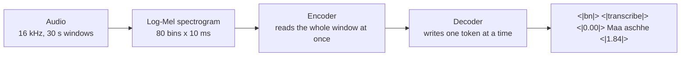
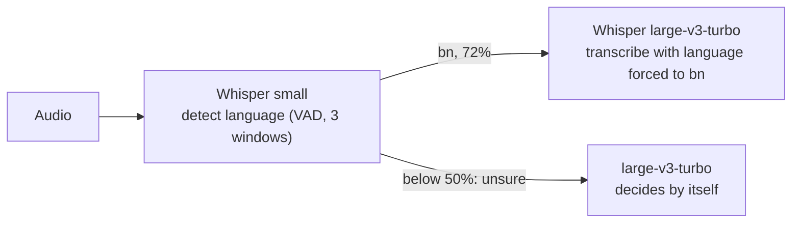

# 4. Speech to text

Code: [`src/frameseek/transcribe.py`](../src/frameseek/transcribe.py)

## Two sources of speech

| Source | Accuracy | Available for | Cost |
|---|---|---|---|
| YouTube manual captions (uploaded by the creator) | Best: written by a person | Few videos | Free, instant |
| YouTube auto captions | Decent in English, weaker for Indian languages and mixed speech | Most videos | Free, instant |
| Local Whisper | Depends on model size and language | Every video | Minutes of compute |

In `auto` mode frameseek uses manual captions if they exist. Auto captions are
used only after a check (below); otherwise Whisper. The choice and the reason are
recorded in `transcript.json` (`source` and `note`).

YouTube lists auto captions in dozens of languages, but all except one are
machine translations. The track ending in `-orig` is the original speech
recognition, so that is the one frameseek takes.

**That track is only as good as the uploader's language setting.** YouTube runs
its recognizer in the language declared for the video, not one detected from the
audio. A Bengali song uploaded with language `hi` gets a Hindi recognizer, which
produces Hindi words that merely sound like the Bengali lyrics:

| Sung (Bengali) | YouTube auto captions (Hindi recognizer) |
|---|---|
| দাঁত কপাটি | दांत कपाटी |
| তোমাকে দেখে | तुम के देखे |

So frameseek treats the auto-caption language as a claim, and checks it: a
Whisper model detects the language from the audio itself (with VAD, so a music intro doesn't
confuse it, voting across up to three 30-second windows). If Whisper is at least
50% sure of a different language, the captions are discarded and Whisper
transcribes instead. Below 50% (for example, a video that is pure music), the
captions are kept rather than overridden on a guess. Manual captions are trusted
without a check.

Auto captions also contain sound markers such as `[Music]` or `[संगीत]`, and
their time ranges overlap as captions roll on screen. Speech coverage is
therefore computed as the **union** of segment ranges, skipping marker-only lines;
a plain sum over-counts (one music video measured 134% "speech" that way).

## How Whisper works

Whisper is an encoder-decoder transformer.



1. **Audio becomes a picture.** A log-Mel spectrogram shows how much energy there
   is at each pitch over time, on a scale that matches human hearing.
2. **The encoder** reads the whole window in parallel, like prefill (Chapter 1).
3. **The decoder** writes tokens one at a time, like decode. Long speech costs
   more decode time.
4. **Language, task and timestamps are tokens too.** Whisper detects the language
   by predicting the most likely language token first.

## Segment vs word timestamps

Whisper's default output gives one start and end per segment, often 5 to 25
seconds long. To answer "when does she say *anjali*?", frameseek needs the time
of the word itself.

Word timestamps come from the decoder's **cross-attention**: while writing each
word, the decoder attends most strongly to the audio frames where that word was
spoken. Aligning those peaks gives each word a start and end. faster-whisper does
this with `word_timestamps=True`. YouTube's auto captions also carry per-word
offsets (`tOffsetMs` in the json3 format), which frameseek keeps.

## Hallucinations on music and silence

Whisper was trained on a large amount of captioned web video and always tries
to produce text. Given only music, it may write something plausible for that kind
of video, such as "subscribe to the channel", and once it has written a line it
can get stuck repeating it.

Two settings guard against this:

| Setting | What it does |
|---|---|
| `vad_filter=True` | A small voice-activity model (Silero VAD) finds the stretches with speech; Whisper only sees those |
| `condition_on_previous_text=False` | Each segment is decoded without the previous text as context, so one bad line cannot start a loop |

## Measured: one Bengali song (4.8 min), MacBook Air 16 GB

| Run | Transcription time | Output |
|---|---|---|
| YouTube auto captions (uploader said Hindi) | 3 s | Hindi words that sound like the lyrics: wrong language |
| Whisper `small`, CPU int8 | ~140 s | Bengali detected (72%), but written in **Devanagari** |
| Whisper `small`, MPS (experimental) | ~135 s | No faster; **half the lyrics missing**, script switches to Latin mid-song |
| Whisper `large-v3-turbo`, CPU int8, `--language bn` | ~144 s | **Bengali script**, recognisable lyrics with spelling slips |
| Whisper `large-v3-turbo`, CPU int8, language detected by turbo | ~85 s | Heard **English (83%)**: translated the dialogue into English, wrote lyrics in Gujarati script, filled gaps with "Thank you." |

Times exclude the one-time model download and load. Three lessons:

1. Model size fixed the script problem at almost no speed cost: turbo's decoder
   is small, and decoding is the token-by-token part.
2. The experimental MPS backend changed the output, not just the speed, so it
   stays opt-in.
3. **Turbo transcribes well but identifies languages badly.** Whisper picks the
   language with its decoder (predicting the first `<|xx|>` token), and turbo's
   decoder was cut from 32 layers to 4 and retrained for transcription. On this
   song `small` heard Bengali twice; turbo heard English.

## Two models: one to detect the language, one to transcribe

So frameseek splits the job:



`transcribe.language_model` (default `small`) does the detection; its answer is
forced onto `transcribe.whisper_model` (default `large-v3-turbo`) when it is at
least 50% confident. `--language` skips detection entirely. One data point does
not make a benchmark: Chapter 10 measures language ID properly, and Chapter 11
compares Whisper with dedicated language-ID and Indian-language models.

## Choosing a model

| faster-whisper model | Size | Notes |
|---|---|---|
| `small` | ~460 MB | Quick tests; weak on Bengali script |
| `medium` | ~1.5 GB | Noticeably better for Indian languages |
| `large-v3-turbo` | ~1.6 GB | Default. Large encoder, small decoder: close to large-v3 quality at about `small` speed on CPU |

`beam_size: 5` keeps several candidate transcriptions at each step and picks the
best; `beam_size: 1` (greedy) is faster and slightly less accurate.

## Devices: not every library supports every GPU

faster-whisper runs on CTranslate2, which supports CUDA and CPU. Version 4.9
added an **experimental** MPS backend for Apple Silicon. frameseek never picks it
automatically; set `transcribe.device: mps` (or `--device mps`) to try it and
compare speed against CPU.

The vision model is different again: it runs inside Ollama, which chooses its
own device (Metal on Apple Silicon). `frameseek doctor` asks Ollama how much of
the loaded model sits in GPU memory instead of guessing, and lists each engine's
device separately.

## Hard cases for Indian content

- **Songs:** stretched vowels and music under the voice cause many more errors than speech.
- **Code-mixing:** "kal meeting ke baad deadline discuss karenge" can come out with
  one language mangled, or with the script switching between Latin and Devanagari.
- **Bengali and Telugu** have much less Whisper training data than Hindi.
  Chapter 11 compares Whisper with models built for Indian languages.
- **Right language, wrong script.** Whisper `small` detected Bengali (72%) on a
  Bengali song but wrote it in Devanagari: "तुमके देखे आमर" is the Bengali
  "তোমাকে দেখে আমার" spelled with Hindi letters. The language token steers the
  decoder towards Bengali but does not force a script, and the small model has
  seen far more Hindi. Larger models (`medium`, `large-v3-turbo`) usually keep
  the right script; since Bengali and Devanagari map almost letter for letter,
  transliterating afterwards is a cheap fallback.

## Output

```json
{
  "source": "youtube-auto",
  "language": "bn",
  "language_from": "YouTube speech recognition",
  "params": {"source": "auto", "whisper_model": "small", "vad": true, "beam_size": 5, "language": ""},
  "segments": [
    {"start": 12.4, "end": 15.1, "text": "...",
     "words": [{"w": "Maa", "start": 12.4, "end": 12.8}]}
  ]
}
```

As with shots, `params` is part of the cache key: changing the model or source
re-runs the step. `language_from` records how the language was decided:
`forced in config`, `detected by Whisper small (72%)`, or the caption track.

## Check your understanding

1. A video opens with a 40-second dhak intro and Whisper without VAD writes
   "Subscribe to the channel" at 0:25. Why, and what fixes it?
2. Why is a word timestamp a better answer than a segment timestamp for "when
   does she say *anjali*?", and which part of Whisper makes it possible?
3. A Bengali song uploaded as Hindi gets Hindi YouTube auto captions. Why, and
   why does Whisper's own language detection avoid this problem?
4. Whisper detects Bengali correctly but writes Devanagari. What is going on?
5. Why can `large-v3-turbo` transcribe well yet misidentify the language?
