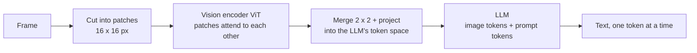

# 5. Vision-language models

Code: [`src/frameseek/caption.py`](../src/frameseek/caption.py),
[`src/frameseek/models/vision.py`](../src/frameseek/models/vision.py)

## How a VLM sees a frame

A vision-language model (VLM) is a language model with an image encoder in front.



1. **Patches.** The image is cut into small squares.
2. **Vision encoder.** A transformer (ViT) turns each patch into a vector; patches
   attend to each other, so a patch "knows" it is part of a car or a letter.
3. **Merge and project.** Neighbouring patches are merged and mapped into the
   language model's embedding space. Each result is one **image token**.
4. **The LLM** then treats image tokens like word tokens, with 2D position
   information so it knows where each one came from.

This is why image size drives prefill time (Chapter 1): more pixels, more image
tokens, more to read before the first word.

How many image tokens a frame becomes depends on the runtime's preprocessing,
so it is best **measured**. `frameseek bench-vision <image>` captions one frame at
several sizes and prints the actual input tokens and timing.

### Measured: Ollama ignores our image size

On a MacBook Air (16 GB), Qwen3-VL-8B through Ollama, one 1280x540 keyframe:

| Size sent | Input tokens | Read (prefill) | Output tokens | Write (decode) |
|---|---|---|---|---|
| 384 | 1215 | (cache hit) | 206 | 13.9 s |
| 512 | 1215 | 16.1 s | 202 | 13.2 s |
| 640 | 1215 | 16.2 s | 197 | 13.5 s |
| 768 | 1215 | 16.4 s | 206 | 15.5 s |
| 1024 | 1215 | 18.3 s | 192 | 21.5 s |

Three lessons from this one table:

1. **The token count never changed.** Ollama resizes every image to its own
   target size for this model, upscaling small ones. Downscaling before sending
   saves nothing and throws detail away, so Frameseek sends full-size keyframes.
2. **Benchmarks can measure caches instead of work.** The first row's warm-up
   used the same image and prompt, so Ollama reused its cached prefill. Ollama
   also keeps cached work across requests, so a later run on the same image hit
   it again (8B prefill "1.6 s"). `bench-vision` now changes one random pixel in
   every row's copy of the image, so each row is a genuine cold read.
3. **Fanless laptops throttle.** Decode fell from ~15 to ~9 tokens/s across the
   run with identical inputs: the chip slowed down as it heated up.

The levers that remain are **output length** and **model size**, below.

## Structured captions

Each keyframe gets a JSON caption instead of a paragraph:

```json
{
  "summary": "Women in red-bordered white sarees dance with dhunuchi in front of a pandal",
  "shot": "wide",
  "people": {"count": 4, "description": "women in white sarees with red borders"},
  "objects": [{"name": "dhunuchi", "colour": "brass"}, {"name": "pandal", "colour": "gold and red"}],
  "text_on_screen": ["শুভ বিজয়া"],
  "setting": "night, outdoor, festival",
  "action": "dancing"
}
```

| Why JSON | Effect |
|---|---|
| Searchable fields | Colour, count and on-screen text questions can use the matching field |
| Consistent | Every frame has the same fields |
| Shorter | Fewer output tokens than prose for the same facts, so less decode time |
| Parseable | Code can use the result directly |

The `shot` field records camera framing (wide, medium, close-up), so framing can be
searched too.

Captions are written in **English**, where the model is most reliable, but
on-screen text is copied **verbatim in its original script**: it is evidence, and
translating it would lose information.

## Constrained decoding: JSON that always parses

Writing "respond in JSON" in the prompt is a request; most outputs comply, a few
do not. Frameseek instead passes the JSON schema to Ollama (`format`), which uses
**constrained decoding**:

> At every decoding step, before a token is chosen, every token that would make
> the output invalid for the schema has its probability set to zero.

The model can only produce valid continuations, so every caption parses and has
every required field with the right type. The one remaining failure is running
out of output budget (`num_predict`) before the JSON closes; that is reported as
an error and retried on the next run.

## Making indexing affordable

With image size fixed by Ollama, a frame costs prefill (~16 s for ~1,200 tokens)
plus decode (~13 s for ~200 output tokens): about 30 s, or 45 minutes for 88
keyframes. Two levers:

| Lever | How | Why it works |
|---|---|---|
| Shorter output | Word limits per field, at most 6 objects and 6 text items (`maxItems` in the schema) | Decode is one token at a time, so fewer output tokens is directly less time |
| Smaller model for indexing | `caption.model: qwen3-vl:4b-instruct`, keeping the 8B for answering | Fewer weights to read per token (decode) and less compute per token (prefill) |

Measured on the same keyframe, with the shorter caption format:

| | Qwen3-VL 8B | Qwen3-VL 4B |
|---|---|---|
| Read the image (prefill) | ~16 s | 8.7 s |
| Output tokens | 139 (was ~200 before word limits) | 119 |
| Write (decode) | 9.5 s, 14.6 tokens/s | 4.7 s, 25 tokens/s |
| Per frame | ~25 s | ~13 s |
| Summary | Grand hall with arches, pillars, and chandeliers | Grand hall with arches, chandeliers, and steps |

The 4B decodes almost twice as fast because decode is limited by memory bandwidth
and it has about half the weights to read per token. One frame is not a quality
benchmark (Chapter 10 does that), but it is enough to choose the 4B for indexing.

### The full run

All 88 keyframes with the 4B: **18.2 s per frame on average** (1,240 input tokens,
104 output tokens), 27 minutes in total, no errors. The benchmark predicted
13.4 s; the gap is thermal throttling on a fanless laptop under sustained load.
Indexing happens once per video, so this is acceptable, but benchmark numbers
from a cool machine are optimistic for long jobs.

On-screen Bengali text was read well, with character-level slips on similar
glyphs: সৃজিত read as সুজিত (missing vowel sign), খোশমেজাজে as থেশামেজাজে
(খ and থ confused), INFRA as "INFR A". These are kept as test cases for Indian-script
OCR in Chapter 11.

The second lever mirrors the speech step: a cheaper model does the bulk work
(Whisper `small` for language ID, a 4B VLM for indexing) and a stronger model is
saved for where accuracy matters most (transcription, answering questions).
`bench-vision --model` compares the two on the same frame.

Small details missed by the index are recovered later: when a question needs
them, the answering step crops and zooms into the full-resolution keyframe
(Chapter 8).

## Caching that survives a crash

Captioning takes minutes, so `captions.jsonl` is written **one line per frame,
flushed as each frame finishes**. If the run stops at frame 61, the next run
skips the 60 finished frames.

Each line carries a `key`: a hash of the model, image size, prompt and schema.
Lines with a different key are ignored, so changing any of them re-captions
exactly the frames affected. A half-written last line (from a crash mid-write)
is skipped, and frames that errored are retried.

## VLMs hallucinate too

A VLM can misread text, invent a logo, or miscount people. Mitigations here:

- `temperature: 0` and a prompt that says to leave fields empty rather than guess.
- Captions are only used to **find** candidate moments. Answers come from looking
  at the frames again (Chapter 8) and checking evidence (Chapter 9).

## Check your understanding

1. If a runtime did honour a smaller image size, which questions would lose most,
   and what in the design compensates?
2. Why did sending a 384 px image cost the same tokens as 1024 px in Ollama, and
   why does that make downscaling harmful rather than just useless?
3. What happens differently during decoding when a JSON schema is supplied,
   compared with asking for JSON in the prompt?
4. A run crashes after 60 of 88 frames. What happens on the next run, and why
   does the cache key include the prompt?
