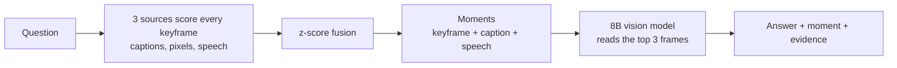

# 7. Retrieval, answering and the UI

Code: [`src/frameseek/answer.py`](../src/frameseek/answer.py),
[`src/frameseek/pipeline.py`](../src/frameseek/pipeline.py),
[`src/frameseek/app.py`](../src/frameseek/app.py)



## Fusing three sources whose scores don't share a scale

Each source scores on its own scale (SigLIP2 around 0.1, e5 around 0.8), so raw
scores cannot simply be added. There are two standard fixes.

### First attempt: reciprocal rank fusion (RRF)

RRF throws the scores away and keeps only positions:

> RRF score = sum over lists of 1 / (k + rank), with k = 60 by default

An item ranked 1st in one list scores 1/61 = 0.0164; 2nd in one list and 3rd in
another scores 1/62 + 1/63 = 0.0320. So RRF rewards agreement between lists.

It failed on this video in two ways:

1. **It ignores how far ahead a match is.** For "guy in a pink cap" the pixels
   ranked pink-cap frames 1st, 2nd, 4th and 5th, but the captions matched the
   word "pink" on a pink basket and a pink flower. Positions can't say "the
   pixels are sure, the captions are guessing".
2. **The speech list is always full.** The song has only 8 speech chunks, and
   all 8 came back for every question. Each one added score to some frame, so
   lyrics nudged the ranking even for "what is written on the t-shirt?". For
   lyric questions the opposite happened: one speech list was outvoted by two
   visual lists agreeing on the wrong frames, and **0 of 4 lyric questions**
   found the right moment.

### What frameseek uses: z-score fusion over the whole video

Score every keyframe with every source (exact search: 88 frames, or a few
thousand for an hour-long video, is a millisecond of numpy), then turn each
source's scores into **z-scores**: how many standard deviations a keyframe sits
above this question's average for the video.

> z = (score − mean) / standard deviation, computed per source, per question

"2 standard deviations above the rest of the video" means the same thing for
SigLIP2 and for e5, so z-scores can be added. A keyframe's score is

> captions z + frames z + speech z (of the chunk playing at that moment)

- A source with a clear winner contributes a big z; a source with no opinion
  (all scores similar) contributes about 0 everywhere. Nothing needs to decide
  which source "should" answer the question.
- Frames with an empty caption get the lowest caption score (never a match).
- Frames with no speech at their time get speech z = 0 (neutral).
- There are no weights or constants to tune.

`frameseek ask` prints each candidate's parts, e.g.
`frames +4.2, captions +3.9, speech +0.0` for "close-up of the goddess face".

## Two stages: recall first, precision second

| Stage | Job | Measured by | Tool |
|---|---|---|---|
| Retrieval | Get the right moment somewhere in a short list | Recall@N (hit@N) | z-score fusion over three sources: cheap |
| Answering | Pick the right moment from that list | Precision of the final answer | Vision model looking at the frames: expensive |

This is the **retrieve-then-rerank** pattern: retrieval only has to get the right
moment into the top 3, and the answering model, which actually looks, picks it.

## Moments

Every keyframe is a candidate moment: the frame, its caption, and the speech
chunk playing at its time. A lyric match lifts all frames inside that chunk
equally, and the pixels and captions decide which of them is shown.

## Answering from evidence

The top `answer.top_n` moments (3 by default) go to the answering model in one
request: their keyframes as images 1 to N, plus each moment's caption and speech.
The output is schema-constrained JSON:

```json
{"answer": "...", "moment": 2, "confidence": "high", "evidence": "what in image 2 shows it"}
```

- `moment` points at one candidate, so the UI can jump to it and show that frame.
  The model cannot cite a moment it was not shown.
- `moment: 0` means none of the candidates answers the question; Chapter 9
  builds on this.
- The prompt tells the model to look at the images, because captions miss
  details, and to answer in the language of the question.

### Cost

Each frame costs about 1,240 input tokens in Ollama, so 3 frames are about 3,700.
At the 8B's measured ~75 tokens/s prefill, that is roughly 50 s before the first
word, plus a few seconds of decode.

| Option | Effect | Trade-off |
|---|---|---|
| Fewer frames (`top_n: 2`) | ~2,500 tokens | Higher risk of cutting the right moment |
| 4B answers (`answer.model`) | Prefill and decode ~2x faster | Weaker judgement between candidates |
| Skip sources that don't apply | Right moment ranks higher, fewer frames needed | Needs a question-type rule or model |
| Look at one frame at a time, stop early | Often one frame instead of three | More logic: Chapter 8 |

**The context window has to fit all of it.** Ollama gives a model 4,096 tokens
of context unless told otherwise. 3 frames (~3,700) plus captions, Bengali
lyrics (Bengali script costs several tokens per word) and the instructions came
to 4,110 tokens on one test question, and Ollama refused it. frameseek sets
`vision.num_ctx: 8192`. A bigger window costs memory for the KV cache (the
model's notes on every token it has read so far, kept so each new word doesn't
reread everything), about 0.6 GB more on the 8B (36 layers × 8 KV heads × 128
dims × keys and values × 2 bytes ≈ 147 KB per token), and it is sent on every
call because a changed value makes Ollama reload the model.

## v0 baseline: three real questions, checked against the frames

Qwen3-VL 8B, top 3 moments, MacBook Air 16 GB. Each result was checked by looking
at the actual keyframes, captions and speech.

| Question | Right moment in the top 3? | Model's answer | Correct? |
|---|---|---|---|
| "guy in a pink cap" | **No** | "None of these show a pink cap" | Correct refusal: none of the three had one |
| "what is written on the striped t-shirt?" | Yes (moment 1) | "Not legible"; dismissed the correct caption text | **Wrong** |
| "দুর্গা প্রতিমা কোথায় দেখা যায়?" | Yes | 1:55, high confidence | Right |

Time per question: ~3,900 input tokens read in ~54 s, ~65 s in total once the
model is loaded, matching the estimate above.

What went wrong, and where it gets fixed:

1. **Speech noise displaced the right frame.** One speech chunk (55.6 to 77.0 s)
   covered both the wrong frame at 58.8 s and the right one at 72.2 s, and its
   score was folded into the wrong one. Another chunk ranked first by chance and
   lifted an unrelated frame. Speech says nothing about how things look, yet it
   always returns results that add score. Fix: decide which sources a question
   needs before fusing (Chapter 8's planning step).
2. **Small text in a full frame was unreadable.** The shirt text occupies a few
   tokens' worth of pixels at ~1,240 tokens per frame. Fix: crop and zoom into
   the region (Chapter 8).
3. **The model overruled a correct caption.** Fix: check answers against
   evidence (Chapter 9).
4. **A format bug, fixed here.** With `answer` as the schema's first field, the
   model wrote "0" or "moment 1" into it before looking at anything. Ollama
   generates fields in schema order, so `evidence` now comes first, then
   `moment`, then `answer`; a bare number still falls back to the evidence text.

## Measuring retrieval: a 21-question test set

Three questions are anecdotes. [`evals/nRWZBq2hcls.yaml`](../evals/nRWZBq2hcls.yaml)
holds 21 questions about this video (visual, on-screen text, Bengali, lyrics),
each with the keyframes or seconds that answer it, checked by eye.
`frameseek eval <url>` scores retrieval without the answering model, in seconds:

- **hit@3**: the right moment is among the 3 the answering model will see
- **hit@1**: it is first
- **MRR** (mean reciprocal rank): average of 1/rank of the first right moment;
  1.0 means always first, 0.5 means typically second

| Fusion | hit@1 | hit@3 | MRR | Lyric questions (hit@3) |
|---|---|---|---|---|
| Captions only | 14 | 15 | 0.73 | 1/4 |
| Frame pixels only | 12 | 15 | 0.66 | 1/4 |
| RRF, 8 per source (v0) | 13 | 15 | 0.70 | 0/4 |
| RRF, speech limited to its top 1-3 | 13 | 17 | 0.73 | 2/4 |
| **z-score fusion (now)** | **16** | **18** | **0.83** | **2/4** |
| z-score, speech weighted ×1.5 | 16 | 19 | 0.84 | 3/4 |

Out of 21. Weighting speech higher gains one question here and starts losing
visual ones at ×2, so with only 21 questions on one video it would be tuning to
the test set; frameseek keeps equal weights.

The three questions still missed show what retrieval alone cannot fix:

| Question | Why it fails | Where it gets fixed |
|---|---|---|
| "guy in a pink cap" (rank 4) | The 4B's captions never mention the cap, and the opening lyrics add +1.3 to unrelated frames | Ask the captioner about clothing and headwear; look again (Chapter 8) |
| "when do they sing about the dhak?" (rank 7) | English question, Bengali lyrics: the cross-lingual match is weak | Translate the query (Chapter 11) |
| "আমি তো প্রেমিক" (rank 6) | Bengali script in the question matches the Bengali title card's script (captions +4.7, pixels +3.6), not the meaning | Separate on-screen-text matching from meaning (Chapter 11) |

`frameseek eval <url> --answer` also runs the answering model on each question
(about a minute each on a 16 GB Mac) and reports how often it picked a right
moment or said none answers it.

## Measuring answers: the 8B on the same 21 questions

`frameseek eval <url> --answer` on a 16 GB MacBook Air (Qwen3-VL 8B, top 3,
about a minute per question). Each answer was then checked by eye:

| Outcome | Count | Examples |
|---|---|---|
| Right moment, good answer | 15 | T-shirt text read correctly as あなたの右目に (wrong in v0) |
| Right moment, weak answer | 2 | Bengali saree question answered by repeating the question; the title name copied from the caption with an OCR slip (সুজিত for সৃজিত) |
| Right moment retrieved, model said none | 1 | "ঢাক পেটাতে দুখান কাঠি": it ignored the matching lyric because no image shows it |
| Wrong moment | 1 | "when do they sing about the dhak?" → 2:43; retrieval had missed it |
| Said none, and retrieval had missed it | 2 | Pink cap, "আমি তো প্রেমিক": correct given what it was shown |

The model picked a right moment whenever retrieval gave it one, except for the
lyric case, and declined instead of inventing when retrieval failed (2 of 3).
So **retrieval is the main limit**.

### Prompt changes cut both ways

Three instructions were added after that run: count a lyric in the speech text
as evidence (expect transcript misspellings), don't say "moment 1" or repeat
the question, and read on-screen text from the image. The model runs at
temperature 0, so the second run differs only because of the prompt:

| | Run 1 | Run 2 |
|---|---|---|
| Right moment picked | 17/21 | 16/21 |
| "moment 1" / "first image" in answers | 6 | 0 |
| Lyric question "ঢাক পেটাতে দুখান কাঠি" | declined | right |
| "আমি তো প্রেমিক" (not in any of the 3 moments) | declined | **"The speech says 'আমি তো প্রেমিক'"**: invented |
| "man in a grey t-shirt" | right | moment 0, while the answer describes him |
| Title name (screen: সৃজিত) | সুজিত, copied from the caption | still সুজিত |

"Expect misspellings" was read as permission to match a lyric that wasn't
there: a refusal turned into a confident false claim, which is worse. The rule
now says the words must really be in that moment's text. Reading text from the
image changed nothing: at full-frame resolution the 8B reads সৃ as সু too,
which is a job for crop-and-zoom (Chapter 8).

The lesson: a prompt fix for one question can break another, and only the
whole test set shows it. A claim such as "the speech says X" can also be
checked by code against the transcript, which is Chapter 9.

## Shared pipeline, two front ends

`pipeline.py` holds the whole flow so the CLI and the web app behave the same:

- `prepare(url)` runs ingest, shots, transcribe, caption and index, each cached.
- `Asker` keeps the embedders and answering model loaded between questions.

`frameseek ask <url> "question"` prints the candidate moments, the chosen one,
the answer, evidence, a timestamped YouTube link and the timing.

`frameseek ui` opens a Gradio app: paste a link, prepare it (each step is
streamed), ask in English or Bengali, and get the answer with a YouTube player
starting at the chosen moment (`youtube.com/embed/<id>?start=<seconds>`), the
evidence frame, and the other candidates the model was shown.

## Check your understanding

1. Why did RRF rank the pink basket above the pink cap, and why does z-score
   fusion handle a source that has "no opinion" better?
2. Estimate the time to first word for 3 frames on the 8B, and give one way to
   reduce it.
3. Why does the answer have to name a moment number rather than a free-form time?
