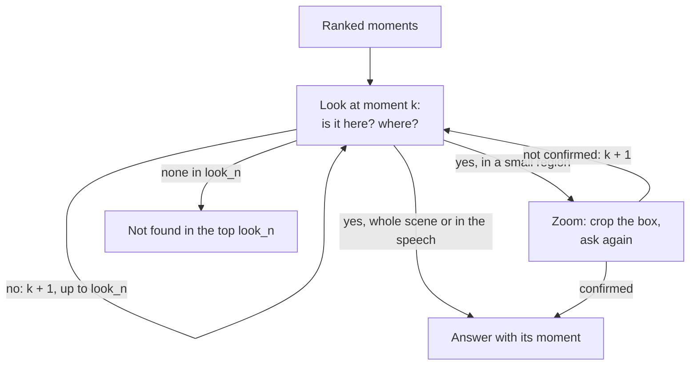

# 8. Looking again: grounding, crop and zoom

Code: [`look.py`](../src/frameseek/look.py), [`zoom.py`](../src/frameseek/zoom.py)

Chapter 7's answering step sees the top 3 frames once, each shrunk to the same
token budget. Two real failures came from that:

- **Small details are unreadable.** The title card says **সৃজিত**; the 8B read
  **সুজিত** (one vowel sign under স) in all three runs.
- **The 4th frame is never seen.** For "guy in a pink cap", the best pink-cap
  frame was ranked 4th, so the model correctly said none of the 3 showed one.

This chapter makes the model look again: one frame at a time, zooming into the
part that matters.

## Where the tokens go

Ollama spends about **1,240 tokens on any image**, whatever its size (measured
in Chapter 5). Qwen3-VL cuts the image into 16-pixel patches and merges each
2×2 group into one token, so each token stands for one cell of a grid laid over
the image.

The T-shirt text in `kf_0019` is about 115×24 pixels of a 1280×540 frame:

> 1,240 tokens × (115 × 24) / (1280 × 540) ≈ **5 tokens** for seven Japanese characters

A crop is also an image, so it also gets ~1,240 tokens. A 184×160-pixel crop
around the text gives the text about **120 tokens**, and each token covers about
5 original pixels instead of 24.

Two details matter:

- **Crop from the original keyframe.** Frames are shrunk to 1024 pixels before
  being sent; a crop of that copy would only enlarge pixels already averaged
  away. The crop is cut from the 1280-pixel keyframe.
- **Zoom can't add pixels the video never had.** The video was downloaded at
  720p. In the T-shirt crop the characters are only a few pixels tall and
  blurry; the title card, in large type, is crisp. If source resolution turns
  out to be the limit, the fix is downloading at a higher resolution.

## Grounding: asking where

Qwen3-VL can answer "where" with a **box**: `[x1, y1, x2, y2]`, top-left to
bottom-right, in **relative coordinates from 0 to 1000** whatever the image size
(Qwen2.5-VL used absolute pixels). So a box from the 1024-pixel copy maps
straight onto the 1280-pixel original:

> pixel x = x / 1000 × width, pixel y = y / 1000 × height

The box comes back through the same JSON-schema output as everything else
(`box`: an array of 4 integers), so it always parses. `zoom.parse_box` still
guards against the model's habits: swapped corners are put in order, values are
clamped to the image, and `[0, 0, 0, 0]` means "not in the image".

## Crop and zoom

`zoom.crop_pixels` turns a box into a crop:

| Rule | Value | Why |
|---|---|---|
| Margin | 30% of the box's size on each side | Model boxes are often a little tight or off |
| Minimum side | 160 original pixels | Smaller is mostly blur once enlarged, and loses the context around the thing |
| Stay inside | slide, don't shrink | A box at the bottom edge (the T-shirt text) still gets a full-size crop |
| Skip | box over 50% of the frame | Zooming into the whole scene adds nothing |

The crop is then enlarged so its longest side is 1024 pixels. Enlarging adds no
detail; it means every original pixel is seen at a useful size whatever the
backend's own resizing does. Crops are saved to `data/<video_id>/crops/`, so you
can see exactly what the model read.

## The loop

Each **look** is one frame plus its caption and speech. The schema asks, in
order: `seen` (what relates to the question), `present`, `source` (image,
speech or none), `box`, `answer`. Field order matters for the same reason as in
Chapter 7: the model writes what it sees before it decides.

The **zoom** is a second, independent look at the close-up. It has to confirm
the thing is there, so a wrong "yes" from the full frame (a pink bowl taken for
a pink cap) usually dies here, and the loop moves on.

One check is code, not prompt: a "yes, it's in the speech" for a moment with no
speech at all is rejected. That was the invented "The speech says 'আমি তো
প্রেমিক'" from Chapter 7, on a title card with no speech. Chapter 9 extends
this kind of check.

## Cost

Estimates from Chapter 5's measurements on a 16 GB MacBook Air (8B: ~75
tokens/s reading, ~15 tokens/s writing). A look or a zoom is ~1,500 tokens in,
~60 out: about 24 s.

| Case | Chapter 7: top 3 at once | Look again |
|---|---|---|
| Right moment ranked 1st (16 of 21 test questions) | 1 call, ~3,850 tokens, ~65 s | look + zoom, ~3,000 tokens, ~50 s |
| Right moment ranked 4th (pink cap) | never seen | 4 looks + zoom, ~2 min |
| Not in the video | 1 call | look_n looks: ~2.5 min at look_n = 6 |

Because the loop stops at the first confirmed moment, look_n only costs time
when the answer is missing or ranked low. Raising it to 20 would make "not in
the video" take about 8 minutes, and frames that far down are weak matches,
so each extra look adds more chances of a false "yes" than of a real find.

What's given up: the model no longer compares frames side by side, so it can't
pick "the clearest" of several right frames; the first confirmed one wins.
`answer.mode: compare` keeps Chapter 7's behaviour, and `frameseek eval
--answer --mode look|compare` compares the two on the same questions.

## Measuring it

`evals/nRWZBq2hcls.yaml` now also lists the exact text some answers must
contain (`contains`), so `eval --answer` scores answer text automatically:

| Question | Must contain | Chapter 7 (compare) |
|---|---|---|
| what is written on the striped t-shirt? | あなたの右目に | right (copied from the caption) |
| what is the name in the opening title? | সৃজিত | wrong: সুজিত |
| Emperor vs Sarat Chandra poster | Sarat Chandra | right |

## First real runs

Qwen3-VL 8B on a 16 GB MacBook Air. The boxes were accurate in all three
crops (title text, the man in the pink cap, the shirt text).

| Question | What happened | Result |
|---|---|---|
| guy in a pink cap | Rejected 0:32 (grey t-shirt), 0:58 (pink **bowl**), 0:37; found the cap at 1:01 (ranked 4th); zoom confirmed | **Fixed**: Chapter 7 never saw this frame. 5 calls, 128 s |
| what is the name in the opening title? | Rejected the end credits, found the title card, zoomed | Still wrong: read **সূর্জিত**, the screen says **সৃজিত**. 3 calls, 95 s |
| what is written on the striped t-shirt? | Found it at rank 1, zoomed | Read **あなたの右側に**; the test set says **あなたの右目に**. 2 calls, 52 s |

The two misses fail in different places, and only one of them is about pixels:

- **The title is a reading problem, not a resolution problem.** The crop is
  crisp and the ৃ (ri-kar) sign under স is plain to a Bengali reader. The 8B
  writes a different vowel sign plus an extra র-phala. Zooming can't fix a
  model that doesn't know the glyph; that's Chapter 11 (Indic scripts).
- **The T-shirt is at the resolution limit.** At 720p, two of the seven
  characters are a few blurred pixels. 右目 (right eye) and 右側 (right side)
  differ only there, and the test set's answer came from the 4B's caption of the
  same blurry pixels, so the reference itself is unverified. The way to settle
  it is a 1080p frame.

## Memory on a 16 GB machine

During these runs, Safari (playing a YouTube video) froze for 30-40 seconds.
Roughly what was in memory:

| What | Size |
|---|---|
| Qwen3-VL 8B weights (Q4) | ~6 GB |
| Its KV cache at `num_ctx` 8192 | ~1.2 GB |
| Qwen3-VL 4B, if still loaded from captioning (keep_alive 30m) | ~3.3 GB |
| PyTorch + SigLIP2 + multilingual-e5 in each `frameseek` process | ~1-2 GB |
| macOS, Safari with a video playing | several GB |

That is at or past 16 GB. macOS then compresses and swaps memory, and every
app stalls while it does. The slowest moment is loading the 8B (the first look
took 50 s instead of ~21 s). frameseek now unloads the captioning model after
captioning when a different model answers questions (`OllamaVision.unload`:
`keep_alive: 0`), so the 4B and the 8B are not held side by side.
`ollama ps` shows what is loaded right now.

## Check your understanding

1. A 184×160 crop and the full 1280×540 frame cost the same ~1,240 tokens. Why
   does the crop read the T-shirt better, and why must it come from the
   original keyframe rather than the 1024-pixel copy?
2. The model says "yes" on moment 1 but is wrong. What in the loop catches it,
   and what does raising look_n from 6 to 20 cost?
